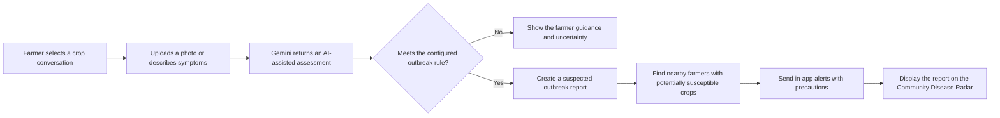

# CropRadar 🌱

**AI-assisted crop health guidance and community outbreak early warnings for farmers.**

CropRadar helps farmers inspect crop symptoms, keep crop-specific conversations, and share timely warnings when a possible disease or pest outbreak could affect nearby farms. Its central idea is a community early-warning network: an AI-assisted diagnosis can trigger relevant precautions for nearby farmers growing susceptible crops.

> **Project status:** Active web-app project and prototype. AI diagnoses and outbreak reports are advisory and unverified unless explicitly confirmed through a future expert-review process.

## Live project

- **Application:** [crop-radar-roan.vercel.app](https://crop-radar-roan.vercel.app/)
- **Source code:** [github.com/ABHIRAM-afk/CropRadar](https://github.com/ABHIRAM-afk/CropRadar)

## Why CropRadar?

Farm disease information is most useful when it reaches the right farmers early. A diagnosis tool that only helps the person who uploaded a photo misses the opportunity to help neighboring farms prepare. CropRadar combines crop-level assistance with a location-aware radar and targeted in-app alerts, so farmers can scout and take sensible precautions when a potentially relevant report appears nearby.

## What it does

### Crop-specific conversations

- Start a conversation for a crop cycle, such as paddy, tomato, chilli, cotton, or turmeric.
- Keep each crop cycle’s questions and observations in its own thread.
- Ask questions or submit a crop photo in the context of the selected crop.

### AI-assisted crop guidance

- Analyze crop images and farming questions with Gemini multimodal AI.
- Present a suspected condition, visual observations, a match score, and suggested management steps.
- Support English and Telugu experiences, including voice-oriented interaction where available.
- Clearly label AI-assisted results as unverified; a visual match score is not a calibrated probability or a confirmed diagnosis.

### Community Disease Radar

- View outbreak reports on a Leaflet map using OpenStreetMap tiles.
- Show the farmer’s own reports separately from nearby reports while keeping other reporters’ identities private.
- Target in-app outbreak alerts to nearby farmers whose crops may be susceptible, within the configured radius (currently designed around a maximum of 5 km).
- Include practical precautions with relevant alerts.
- Allow a farmer to remove a report from their own radar view without hiding it from other farmers. Only the report’s owner can delete a shared outbreak for everyone.

### Farmer tools

- Farm profile and location settings for proximity features.
- Weather-aware spray advisories.
- Field Diary for saving observations and crop-health history.
- Pesticide-label scanning and treatment guidance features.
- Responsive light-theme interface with mobile layouts.

## How the early-warning flow works



Exact diagnosis thresholds, host-crop matching, location filtering, and delivery behavior should be confirmed in the current source code and deployment before being relied on operationally.

## Technology

| Area | Technology |
|---|---|
| Frontend | React, TypeScript, Vite |
| Backend/API | Express, deployed through Vercel serverless routing |
| Database and authentication | Supabase Postgres and Supabase Auth |
| Image storage | Supabase Storage |
| AI | Google Gemini API |
| Map | Leaflet and OpenStreetMap |
| Hosting | Vercel |

## Data, privacy, and safety

- Server-side actions should use the verified Supabase session to identify the current user; never trust a user ID supplied by the browser.
- Crop conversations, diary entries, notifications, and personal radar removals should be scoped to the authenticated account.
- Public/community map views should avoid exposing exact farm coordinates or reporter identity.
- “Remove from my radar” is a personal preference. “Delete for everyone” removes the owner’s shared report and its linked alerts. These are separate operations.
- Personal notification expiry is separate from radar removal and shared-report deletion.
- Alerts and AI results are not field-confirmed or a substitute for local agricultural extension advice. Treatment suggestions, especially chemical use and dosage, should be checked against product labels and trusted local guidance.
- The current alert channel described by the project is **in-app notification**. Do not assume SMS or phone push delivery is available.

## Run locally

### Prerequisites

- Node.js and npm
- A Supabase project configured for the app
- A Gemini API key for AI-backed features

### Setup

1. Clone the repository and enter the project directory:

   ```bash
   git clone https://github.com/ABHIRAM-afk/CropRadar.git
   cd CropRadar
   ```

2. Install dependencies:

   ```bash
   npm install
   ```

3. Create a local `.env` file based on `.env.example`. Add the required Supabase, Gemini, and app URL settings using the exact variable names in the template. Keep `.env` private; never commit API secrets or service-role keys.

4. Configure Supabase Auth redirect URLs for your local address and deployed Vercel domain. Configure the required database tables, Row Level Security policies, and Storage bucket according to the checked-in project migrations and current application code. Review migrations before applying them to an existing database; do not blindly rerun migrations on a database that already contains app data.

5. Start the local development server using the script defined in `package.json` (typically `npm run dev`).

## Checks

The project has previously reported successful TypeScript checks, production builds, and automated tests. Run the commands currently defined by `package.json` before submitting changes; for example:

```bash
npm run lint
npm run build
```

Run the repository’s relevant test scripts as well. A successful local build does not by itself verify Supabase policies, Vercel API routing, or production behavior; test important flows on the deployed app too.

## Known limits

- Image-based disease matching can be wrong, especially with blurry images, mixed symptoms, or unsupported crops.
- A visual match score should not be described as a scientifically validated probability.
- Community reports may be false positives and are not expert-verified in the current design.
- Location accuracy, crop-host compatibility, and alert delivery depend on correct farmer profiles, consented location, database policies, and production configuration.
- The app currently focuses on in-app alerts; SMS, push delivery, and agronomist review are future work.

## Roadmap

These are **future plans**, not claims that the features are already implemented:

1. **Agronomist verification:** Add an optional review workflow for suspected outbreaks. An expert or extension officer could verify a report before it receives a verified label or wider distribution.
2. **Measure diagnostic quality:** Build an expert-reviewed evaluation set and track false positives, missed cases, and performance by crop, disease, image quality, and region. Calibrate thresholds based on evidence.
3. **Improve outbreak intelligence:** Cluster duplicate reports, gather community confirmations, improve crop-host matching, and refine risk-based notification targeting.
4. **Expand delivery options:** Explore opt-in mobile push or SMS for urgent alerts, with language preferences and delivery status.
5. **Strengthen local guidance:** Develop reviewed, crop-stage-specific regional guidance in Telugu and other local languages, with links to trusted agricultural sources.
6. **Support low connectivity:** Add offline-friendly workflows and delayed uploads for farmers with unreliable internet access.
7. **Pilot and measure impact:** Work with farmers and agricultural organizations to measure whether early warnings improve scouting and reduce avoidable losses.
8. **Grow regional coverage:** Add crops, regional disease knowledge, seasonal context, and local partnerships based on farmer feedback.

## Contributing

Contributions should preserve account isolation, location privacy, clear uncertainty labels, crop-specific context, and the separation between personal notification actions and shared outbreak actions. For changes involving database schema or security policies, include a reviewed migration and document how it should be applied safely.

## License

No license information was provided in the project context. Add a `LICENSE` file before presenting the repository as open source or permitting reuse.
